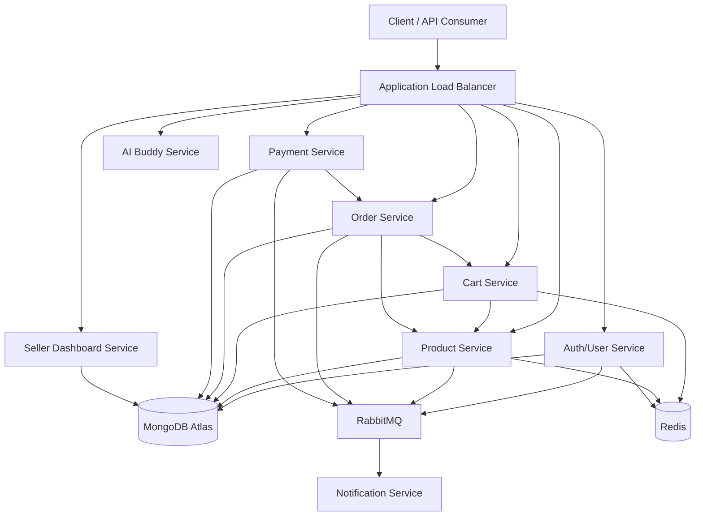

# Marketplace Microservices Backend

A backend-focused e-commerce marketplace built around microservices, secure APIs, event-driven communication, and scalable backend architecture.

---

## 1. Overview

Marketplace is a microservices-based e-commerce backend designed to support customers, sellers, product management, shopping carts, orders, payments, notifications, and intelligent shopping assistance.

The system is designed around independently organized services, with a focus on backend engineering, service boundaries, asynchronous communication, security, and reliable business workflows.

### Core Capabilities

- User authentication and profile management.
- Product catalog and seller inventory management.
- Shopping cart management and price validation.
- Order processing and lifecycle management.
- Payment integration with Razorpay.
- Asynchronous event-driven communication.
- Notifications and order updates.
- Seller analytics and dashboard data.
- AI-assisted product discovery.

---

## 2. Current Implementation Status

Implementation status will be updated as each component is developed, integrated, and tested.

| Component | Status |
|---|---|
| Auth/User Service | Not yet verified |
| Product Service | Not yet verified |
| Cart Service | Not yet verified |
| Order Service | Not yet verified |
| Payment Service | Not yet verified |
| Notification Service | Not yet verified |
| Seller Dashboard Service | Not yet verified |
| AI Buddy Service | Not yet verified |
| RabbitMQ Integration | Not yet verified |
| Redis Integration | Not yet verified |
| Security Implementation | Not yet verified |
| Automated Testing | Not yet verified |
| AWS Deployment | Not yet verified |

> Statuses are updated based on actual implementation, integration, and verification rather than architectural plans.

---

## 3. Tech Stack

The following technologies are part of the project blueprint. Their implementation status will be reflected as development progresses.

| Category | Technology |
|---|---|
| Runtime | Node.js |
| Backend Framework | Express.js |
| Database | MongoDB Atlas |
| Message Broker | RabbitMQ |
| Caching | Redis |
| Authentication | JWT |
| OAuth | Google OAuth / Passport.js |
| Payment Gateway | Razorpay |
| Validation | Zod / Express Validator |
| Security | Helmet, CORS, CSRF Protection, XSS Sanitization |
| Rate Limiting | Redis |
| Logging | Morgan, Pino |
| Containerization | Docker |
| Cloud Infrastructure | AWS |
| Container Registry | Amazon ECR |
| Compute | Amazon ECS Fargate |
| Load Balancing | Application Load Balancer |
| Monitoring | Amazon CloudWatch |

---

## 4. Architecture

The system is designed around independent backend services with clearly defined responsibilities.

Services communicate through REST APIs where synchronous interaction is required and RabbitMQ events for asynchronous workflows.

### Planned Architecture



> This diagram represents the proposed architecture and will be updated to reflect the actual implementation, service boundaries, databases, and communication paths.

### Communication

- **REST APIs:** Synchronous communication between services where immediate responses are required.
- **RabbitMQ:** Asynchronous communication through domain events.
- **Redis:** Caching, rate limiting, and supporting selected performance-related workflows.

---

## 5. Services

### Auth/User Service

Responsible for authentication, authorization, user profiles, and address management.

- User registration and login.
- JWT access and refresh token management.
- Google OAuth authentication.
- Role-based access control.
- Profile and address management.
- Refresh session revocation.
- User-related event publishing.

### Product Service

Responsible for product catalog and seller product management.

- Product creation, modification, and archival.
- Product search and filtering.
- Category and price filtering.
- Pagination and sorting.
- Seller product management.
- Product information retrieval.
- Product-related event publishing.

### Cart Service

Responsible for customer shopping cart operations.

- Add and remove cart items.
- Update item quantities.
- Retrieve cart contents.
- Validate prices and availability.
- Recalculate cart totals.
- Maintain customer cart data.

### Order Service

Responsible for order creation and lifecycle management.

- Create orders from shopping carts.
- Store order item price snapshots.
- Manage order lifecycle and status.
- Inventory reservation workflows.
- Order cancellation rules.
- Order history and retrieval.
- Shipping address management.

### Payment Service

Responsible for payment processing and transaction management.

- Razorpay order creation.
- Server-side payment verification.
- Payment status management.
- Payment record retrieval.
- Idempotent payment operations.
- Payment success and failure event publishing.

### Notification Service

Responsible for event-driven notification delivery.

- Consume relevant RabbitMQ events.
- Send notifications.
- Track notification delivery status.
- Handle delivery failures.

### Seller Dashboard Service

Responsible for aggregating seller-specific business information.

- Sales metrics.
- Revenue analytics.
- Seller order information.
- Product inventory.
- Low-stock alerts.
- Top-performing products.

### AI Buddy Service

Responsible for intelligent shopping assistance.

- Parse natural language product queries.
- Query product information based on user intent.
- Assist with product discovery.
- Assist with shopping cart operations.

---

## 6. Engineering Highlights

This section documents engineering implementations and decisions as they are completed.

| Engineering Area | Implementation |
|---|---|
| Authentication | JWT-based access and refresh token architecture |
| Authorization | Role-Based Access Control (RBAC) |
| Session Management | Refresh session revocation |
| Messaging | RabbitMQ event-driven communication |
| Caching | Redis-based caching |
| Rate Limiting | Redis-backed rate limiting |
| Payment Processing | Razorpay integration and server-side verification |
| Idempotency | Applied to selected business operations |
| Validation | Request validation using Zod or Express Validator |
| Logging | Morgan and Pino |
| Request Tracking | Request ID correlation |
| Security | HTTP security headers, CORS, CSRF, sanitization |
| Error Handling | Consistent API error handling |
| Scalability | Independent service boundaries |

> Only implemented and verified engineering capabilities will be presented as completed achievements.

### Event-Driven Communication

RabbitMQ is designed to support asynchronous communication between services.

| Event | Purpose |
|---|---|
| `user.created` | New user registration |
| `user.updated` | User profile updates |
| `product.created` | Product creation |
| `product.updated` | Product modification |
| `product.deleted` | Product archival or removal |
| `order.created` | Order creation |
| `order.cancelled` | Order cancellation |
| `payment.success` | Successful payment |
| `payment.failed` | Failed payment |

These events are intended to reduce direct service dependencies and support asynchronous business workflows.

> Event contracts, exchange configuration, routing keys, consumers, retries, and failure handling will be documented as they are implemented.

---

## 7. API Documentation

API documentation will be organized by service and updated alongside endpoint implementation.

### Auth/User Service

| Method | Endpoint | Description |
|---|---|---|
| POST | `/auth/register` | Register a customer or seller |
| POST | `/auth/login` | Authenticate a user |
| POST | `/auth/logout` | Revoke the current session |
| GET | `/auth/me` | Retrieve current user information |
| PATCH | `/auth/users/me` | Update profile |
| GET | `/auth/users/me/addresses` | Retrieve saved addresses |
| POST | `/auth/users/me/addresses` | Add a saved address |
| DELETE | `/auth/users/me/addresses/:addressId` | Remove an address |

### Product Service

| Method | Endpoint | Description |
|---|---|---|
| GET | `/products` | Retrieve products with filters and pagination |
| GET | `/products/:id` | Retrieve product details |
| POST | `/products` | Create a product |
| PATCH | `/products/:id` | Update a product |
| DELETE | `/products/:id` | Archive or delete a product |
| GET | `/products/seller` | Retrieve seller products |

### Cart Service

| Method | Endpoint | Description |
|---|---|---|
| GET | `/cart` | Retrieve current cart |
| POST | `/cart/items` | Add an item |
| PATCH | `/cart/items/:productId` | Update item quantity |
| DELETE | `/cart/items/:productId` | Remove an item |
| DELETE | `/cart` | Clear the cart |

### Order Service

| Method | Endpoint | Description |
|---|---|---|
| POST | `/orders` | Create an order |
| GET | `/orders/:id` | Retrieve order details |
| GET | `/orders/me` | Retrieve customer orders |
| POST | `/orders/:id/cancel` | Cancel an order |
| PATCH | `/orders/:id/address` | Update delivery address |

### Payment Service

| Method | Endpoint | Description |
|---|---|---|
| POST | `/payments/razorpay/order` | Create a Razorpay order |
| GET | `/payments/:id` | Retrieve payment details |
| POST | `/payments/verify` | Verify payment signature |

### Notification Service

Notification delivery is event-driven and its API surface will be documented if external endpoints are introduced.

### Seller Dashboard Service

| Method | Endpoint | Description |
|---|---|---|
| GET | `/seller/dashboard/metrics` | Retrieve seller metrics |
| GET | `/seller/dashboard/orders` | Retrieve seller orders |
| GET | `/seller/dashboard/products` | Retrieve seller inventory |

### AI Buddy Service

AI-assisted shopping endpoints will be documented as they are implemented.

> API documentation will progressively include request examples, response payloads, authentication requirements, validation rules, error responses, and idempotency behavior.

---

## 8. Security

Security is integrated into the architectural design and will be documented according to actual implementation.

### Planned Security Controls

- JWT-based authentication.
- Short-lived access tokens.
- Refresh tokens using HTTP-only cookies.
- Refresh session revocation.
- Role-Based Access Control.
- Password hashing.
- Helmet security headers.
- Configured CORS policies.
- CSRF protection using double-submit cookies.
- XSS sanitization.
- Redis-backed rate limiting.
- Server-side payment signature verification.
- Input validation.
- Request tracking.

---

## 9. Setup

### Prerequisites

The following tools are expected to be required for local development as they are introduced:

- Node.js
- npm
- MongoDB Atlas account or local MongoDB
- Redis
- RabbitMQ
- Git

### Installation

```bash
git clone https://github.com/YOUR_USERNAME/marketplace-microservices-backend.git

cd marketplace-microservices-backend
```

> Service-specific installation and execution commands will be added as the repository structure is established.

### Environment Variables

Sensitive configuration will be managed through environment variables.

An `.env.example` file will document the required configuration without exposing secrets.

Expected configuration categories may include:

- Database connection.
- JWT secrets.
- OAuth credentials.
- Redis connection.
- RabbitMQ connection.
- Razorpay credentials.
- Application configuration.

Actual environment variable names and service-specific setup instructions will be documented as implementation progresses.

---

## 10. Testing

Testing documentation will cover implemented test suites and verified results.

### Testing Strategy

- Unit testing.
- API integration testing.
- Authentication and authorization testing.
- Validation testing.
- Service integration testing.
- Payment workflow testing.
- Event-driven communication testing.
- Error handling testing.

### Test Results

> Test results, test commands, coverage, and verified test scenarios will be added as the testing infrastructure is implemented.

---

## 11. Deployment

### Planned Deployment Architecture

```text
Docker
  ↓
Amazon ECR
  ↓
Amazon ECS Fargate
  ↓
Application Load Balancer
  ↓
Target Groups
  ↓
Independent Microservices
```

### Planned Infrastructure

| Component | Purpose |
|---|---|
| Docker | Containerization |
| Amazon ECR | Container image registry |
| ECS Fargate | Container execution |
| Application Load Balancer | Traffic routing |
| Target Groups | Service routing |
| CloudWatch | Logs and monitoring |

> Deployment documentation will reflect the actual infrastructure, configuration, deployment process, and operational setup once implemented.

---

## 12. Roadmap

### Core Services

- [ ] Auth/User Service
- [ ] Product Service
- [ ] Cart Service
- [ ] Order Service
- [ ] Payment Service
- [ ] Notification Service
- [ ] Seller Dashboard Service
- [ ] AI Buddy Service

### Infrastructure & Engineering

- [ ] RabbitMQ integration
- [ ] Redis caching
- [ ] Redis-backed rate limiting
- [ ] Service-to-service communication
- [ ] Idempotent business operations
- [ ] Centralized logging
- [ ] Request ID correlation
- [ ] Security implementation
- [ ] Automated testing

### Deployment

- [ ] Dockerize services
- [ ] Amazon ECR integration
- [ ] ECS Fargate deployment
- [ ] Application Load Balancer configuration
- [ ] CloudWatch monitoring

---

**Marketplace Microservices Backend — built to explore scalable backend engineering, distributed systems, and production-oriented application architecture.**
